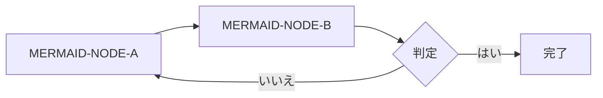
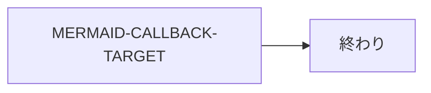
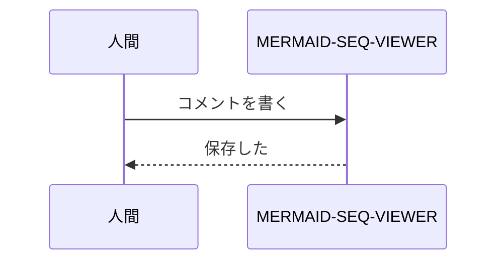

# Mermaid の確認 2026-08-01

e2e 用フィクスチャ。S1-3(Mermaid の描画、不正な記法の扱い、スクリプトを実行しない設定)を確かめるための資料。

この文は表示される: MERMAID-VISIBLE-TEXT-BEFORE

## 1. 正しい図



期待: 図(SVG)として描画される。

## 2. 不正な記法

```mermaid
flowchart LR
  A[[[ これは不正な記法 MERMAID-INVALID --> --> ]
  %% 閉じていない
```

期待: このブロックだけがエラー表示になる。前後の文章と、ほかの図は、そのまま表示される。

## 3. スクリプトを仕込んだ図

```mermaid
flowchart LR
  X["ラベル"] --> Y[MERMAID-CLICK-TARGET]
  click Y "javascript:window.__rvXss=(window.__rvXss||[]).concat('mermaid-click-href')"
```



期待: どちらのブロックも、描画されてもされなくてもよいが、スクリプトは実行されない。
`window.__rvXss` は未定義のまま。ノード(MERMAID-CLICK-TARGET、MERMAID-CALLBACK-TARGET)を
クリックしても何も実行されない。ほかのペイロードと同じく、実行されると `window.__rvXss` に名前が入る。

## 4. 図のあとの文章

この文は表示される: MERMAID-VISIBLE-TEXT-AFTER



期待: 不正なブロックのあとでも、この図は描画される。
