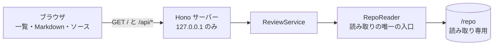

# Stage 1 報告(閲覧・読み取り専用)

作成日: 2026-10-18 / 対象: SPEC §4(S1-1〜S1-9)と共通基準(C-1〜C-6)/ ブランチ: `feature/10-t1-5-path-line-link`(HEAD `4530c8e`)

## 結論(2行以内)

ステージ1の機能(レポート一覧、Markdown・GFM・Mermaid 表示、ソースツリーと行番号つき表示、`path:line` リンク)は実装済み。自動テストは緑(`npm run check` 867 件、`npm run e2e` 183 passed / 1 todo。todo は C-6 の書き込み途中で、ステージ2の保留)。**次へ進む前に、人間の判断が要る。** S1-9 の手動確認、未決の SPEC 曖昧点(Q4、Q6〜Q12)の確定、Q3・Q5 の SPEC 反映、push と CI の初回確認。

## 目的・背景

閲覧できないと、コメント(ステージ2)も AI への指示(ステージ3)も始められない。ステージ1は、資料(Markdown)とソースを並べて読めることを作る段階。あわせて、HTTP 層のセキュリティ基準(C-1〜C-3、C-5、C-6)と、ファイル読み取りの拒否規則(S1-4〜S1-6)を、この段階で回帰テストとして固定した。

## 全体像



## 受け入れ基準の結果

分類: **自動** = 自動テストで確認 / **手動** = 人間の確認が必要 / **一部** = 自動で確認したが、保留の範囲がある

| ID | 分類・結果 | 根拠(テスト名の要旨、または確認したコマンド) |
|---|---|---|
| S1-1 | 自動: 満たす | `api.test.ts` の S1-1 群(一覧、新しい順、対象外の除外)。更新日時の順、同時刻はファイル名の降順(Q3 の決定どおり) |
| S1-2 | 自動: 満たす | `render.test.ts` の S1-2 4 件(表、タスクリスト、コードブロックとハイライト、コードブロック内の HTML が文字として出る) |
| S1-3 | 自動: 満たす | `render.test.ts` の S1-3 3 件(正しい図が SVG、不正記法はそのブロックだけ `mermaid-error`、図の中のスクリプトが実行されない) |
| S1-4 | 自動: 満たす | `api.test.ts` の S1-4 群(`../`、絶対パス、外を指すリンク)と、`RepoReader` の単体テスト |
| S1-5 | 自動: 満たす | `api.test.ts` の S1-5 群(`.env*`、`.git/`、鍵、`.claude.json`、`.gitignore` 対象)と単体テスト |
| S1-6 | 自動: 満たす | `api.test.ts` の S1-6 群。境界は「1,048,576 バイトちょうどは返す」「1,048,577 バイトは返さない」(Q5 の決定どおり)。バイナリは本文なし |
| S1-7 | 自動: 満たす(注意あり) | HTTP で 2 件(XSS を含む応答と見出しを含む一覧が HTML の Content-Type でない)。ブラウザで 4 件(`window.__rvXss` が未定義のまま、javascript: リンク、一覧の見出し、前後の文章が表示される)。**注意: 下の「未確認・懸念点」の 1 を参照** |
| S1-8 | 自動: 満たす | `render.test.ts` の S1-8 2 件(`src/example.ts:1` がリンクになる、クリックで並び表示と該当行の強調) |
| S1-9 | **手動(未確認)** | 人間が確認する(下の「画面を自分で確かめる手順」) |
| C-1 | 自動: 満たす | `api.test.ts` / `security.test.ts` の C-1 群(許可リスト外の Host は 403) |
| C-2 | 自動: 満たす | 同 C-2 群。「GET は Origin が無くても拒否されない」も含めて緑(T1-2 で `GET /api/reports` ができて解消) |
| C-3 | 自動: 満たす | `security.test.ts` の C-3(既定は 127.0.0.1)。外部アドレスへの bind の検査は、環境に外部アドレスがあるときだけ動く(今回の実行では skip は 0 件) |
| C-4 | 自動: 満たす | `src/project-setup.test.ts`(`@anthropic-ai/*` への依存が無い)と、`src/static-checks.test.ts`(`claude` コマンドの起動が無い)。`npm run check` に含む |
| C-5 | 自動: 満たす | `security.test.ts` の C-5 2 件(秘密ファイルの中身とトークンが応答に出ない)と、単体テスト |
| C-6 | **一部** | `security.test.ts` の C-6 2 件(SIGTERM / SIGINT で 5 秒以内に終了し、ポートが閉じる)は緑。**未カバー**: 書き込み途中のシグナル(`it.todo`、ステージ2)。コンテナ内の PID 1 でのシグナル処理(ステージ5) |

## 確認したこと

| 項目 | コマンド | 結果(2026-10-18、このコンテナで実行) |
|---|---|---|
| 検査 | `npm run check` | 通過。24 ファイル、867 件 すべて通過(typecheck、lint、単体テスト) |
| ビルド | `npm run build` | 成功(終了コード 0)。警告: 500kB を超えるチャンク(mermaid、elk の動的 import) |
| システムテスト | `E2E_SKIP_BUILD=1 npm run e2e` | **183 passed / 1 todo**、失敗 0。内訳: `api.test.ts` 99、`security.test.ts` 65、`render.test.ts` 19(うちブラウザ 13 件)。todo は C-6 の書き込み途中 1 件 |
| 基準 ID で絞り込み | `npm run e2e -- -t S1-2` など | 未実行(下の注記を参照) |

- システムテストの実行には、このコンテナ固有の回避が要った。Chromium の OS ライブラリが無いため、`LD_LIBRARY_PATH` と `FONTCONFIG_FILE` を scratchpad 側に向けて実行した(開発用の手順は `README.md` の Playwright の節)。
- 基準 ID での絞り込み(`-t S1-x`)は、Reporter は実行していない(全件の実行で代える)。
- 差し戻し回数: 各タスクの Reviewer の判定記録が見当たらず、**未確認**。メモリの記録では、T1-3、T1-4、T1-5 は 2026-10-18 に APPROVE 済み。

## 未確認・懸念点

1. **S1-7 の `javascript:` リンクの検証は空振りの疑いがある(申告による。Reporter は未検証)。** XSS フィクスチャ `e2e/fixtures/repo/reports/2026-08-02-xss.md` の `<SCRIPT >…</SCRIPT >` が CommonMark の HTML ブロックを閉じず、後ろの `javascript:` リンクの段落を呑み込む。そのため、e2e の「javascript: リンクをクリックしても実行されない」は、リンクが描画されていないまま緑になっている可能性がある。単体テストでは直接検証している。Tester への宿題。
2. **S1-9(手動)と、実機のブラウザでの確認は未実施。** 実際のプロジェクトのレポートを開いたときの見た目と、大きいファイル・バイナリの「表示できません」表示は、自動テストの対象外(PLAN の手動確認の表)。
3. **`/api/reports` の並び順(Q3)と 1MB の境界(Q5)は、SPEC にはまだ書かれていない。** 決定は PLAN に記録されているだけ。
4. **未決の SPEC 曖昧点の現在の解釈は、下の「人間に判断してほしいこと」のとおり。** テストは、どちらの解釈でも通る書き方になっている(PLAN の記録による)。
5. **SPEC §4.1 にない `data-testid` を 2 つ追加した**: `source-line-number`(行番号)、`source-tree`(ソースツリー)。テストはこれに依存していない。SPEC への追記か、取り消すかを決める。
6. **Mermaid の SVG は `dangerouslySetInnerHTML` で挿入している**(`src/client/markdown/MermaidBlock.tsx`)。無害化は、Mermaid の `securityLevel: 'strict'` が内部で使う DOMPurify に依存している。加えて CSP の `script-src 'self'` で、スクリプトの実行を二重に止めている。**Reporter は、このライブラリの内部の無害化を独立には確認していない。**
7. **CSP の `style-src 'unsafe-inline'`**(`src/server/app.ts`)を許している。Mermaid の SVG が `<style>` を含むため。スタイルからの情報漏えいのリスクは、受け入れるかどうか人間の判断が要る。
8. **`path:line` 検出の限界**: `example.com:8080` のような、ポート番号つきのホスト名がリンクになる。`src/日本.ts:3` のような非 ASCII のパスは、切り出しがおかしくなる。インラインコードは、中身が全体で1つの参照のときだけリンクにする(暫定)。
9. **ハイライトの上限 200,000 文字は暫定**(`src/client/source-lines.ts`)。SPEC に規定が無い。超えたファイルは装飾なしで表示する。
10. **push の状態**: リモートにあるのは `main`、`develop`、`feature/6-t1-p1-playwright` だけ(`git ls-remote origin` で確認)。`feature/1`〜`5`、`feature/7` はブランチ名が未 push だが、コミットはすべて push 済みの `feature/6` に含まれる(`git merge-base --is-ancestor` で確認)。`feature/8`、`feature/9`、`feature/10`(T1-3〜T1-5 と本資料)はコミットも未 push。**CI(T1-7)の初回の結果は、まだ無い。**
11. **gitleaks の pre-push フック(`557d3e3`)は、Reviewer を通していない。**
12. **開発コンテナの Chromium**: `/workspace/vibe_coding/docker/Dockerfile` に手順 3.6(`npx playwright@1.64.0 install-deps chromium`)を追加したが、**ビルドは未検証**(このコンテナに podman が無い)。CI は `--with-deps` を使うので影響は無い。
13. **ビルドの警告**: 500kB を超えるチャンク。`dist/client` は約 16MB。
14. **依存の置き場**: 画面のライブラリ(react、mermaid、shiki など)を `dependencies` に置いている。`devDependencies` で足りるかは `doc/oss.md` に検討事項として記載済み(コンテナで `--omit=dev` を使うステージ5で判断)。
15. **残存する古い記述**: `src/static-checks.test.ts` 214 行付近の `TODO(T1-P1)` は、T1-P1 がコミット済み(`ac6e446`)なので、例外(`mustMatch: false`)を外すべき状態のまま残っている。Coder が後片付けする。
16. **暫定の方針の一覧**(コードとテストの「暫定」コメントを grep した結果): `src/server/path-policy.ts`(`.env.example` を拒否など)、`src/server/RepoReader.ts`(拒否は 404 に統一、1MB)、`src/server/ReviewService.ts`(`reports/` の直下だけ)、`src/server/app.ts`(拒否の応答)、`src/client/source-lines.ts`(ハイライト上限、拡張子の対応表 約 25 種)、`src/client/markdown/path-line.ts`、`src/client/styles.css`(画面の見た目は最小限)、`e2e/api.test.ts`(ステータスコードは 5xx 以外を受け入れる)、`e2e/security.test.ts`(終了までの 5 秒を仮定)。
17. **`npm start` の既定の `DATA_DIR`(`/data`)**: ステージ1は書き込まないが、`/data` が無い環境で起動するかは確認していない。手動確認では `DATA_DIR` を明示するとよい。

## 人間に判断してほしいこと

**A. 受け入れの前に必要なこと**

1. **S1-9 の手動確認**(下の手順)を行い、結果を報告する。
2. **push の判断**: 未 push のブランチが多い(上の 10)。`develop` へのマージの順番は、人間が決める。最初の push の前に、履歴全体を gitleaks で確認する(CLAUDE.md)。
3. **SPEC への反映**: Q3・Q5 の決定(2026-10-18)は PLAN にだけある。SPEC §4 の S1-1、S1-6 への追記を人間が行う(案: S1-1 は「更新日時の新しい順。同時刻はファイル名の降順」、S1-6 は「1,048,576 バイトまでは本文を返し、1 バイトでも超えたら返さない」)。

**B. 未決の SPEC 曖昧点(現在の実装の解釈と、選択肢)**

| # | 論点 | 現在の実装 | 選択肢 | おすすめ |
|---|---|---|---|---|
| Q4 | 拒否のステータスコード | 拒否(リポジトリ外、秘密、`.gitignore`、外を指すリンク)は、すべて **404**。形式が不正なパス(`../` や絶対パスなど)だけ **400** | A: 現状どおり / B: 形式不正も 404 | **A**(秘密の有無は 404 で区別できない。形式不正の 400 は、存在の情報を含まない) |
| Q6 | `.env.example` | **拒否する**(SPEC の `.env*` の文字どおり) | A: 拒否 / B: 許可 | **A**(例のファイルに本物の値が書かれる事故を防ぐ) |
| Q7 | 「正常終了」の定義 | e2e は**終了コードを見ていない**(5 秒以内に終了し、ポートが閉じることだけ) | A: 終了コード 0 も検証する(Tester の作業) / B: 現状のまま | **A** |
| Q8 | `/api/reports` の見出し | 一覧は**ファイル名(パス)だけ**を表示し、見出しは出さない | A: 現状(見出しを出さない) / B: 見出しを追加 | **A**(ステージ1の範囲を広げない) |
| Q9 | `.gitignore` の範囲 | ルートと途中のディレクトリの `.gitignore` を、git と同じ優先順で使う。否定パターンも扱う。秘密の判定は常に優先(`src/server/gitignore.ts` の冒頭コメント) | A: 現状 / B: ルートだけ | **A**(**Reporter はこの挙動のテストの網羅を確認していない**) |
| Q10 | `reports/` のサブディレクトリ | **含めない**(直下の `.md` だけ) | A: 現状 / B: 含める | **A** |
| Q11 | 外を指すシンボリックリンク | **一覧に出さない**(取得も拒否) | A: 現状 / B: 出す | **A** |
| Q12 | `Host` が無い・不正なとき | テストは 400 も 403 も許容。**実装の応答は未確認** | どちらでもよい | 決めるだけでよい |

**C. 設計・依存の判断**

- **SPEC §4.1 にない `data-testid` 2 件**(`source-line-number`、`source-tree`)を、SPEC に追記するか、取り消すか。
- **CSP の `style-src 'unsafe-inline'`** と、**Mermaid の内部の無害化への依存**(上の 6、7)を、受け入れるか。
- **依存の追加**(CLAUDE.md ルール 11 の記録は `doc/oss.md`。いずれも MIT、ただし playwright は Apache-2.0)。追加したのは次のとおり。

| 区分 | 追加したもの(版) | 用途 |
|---|---|---|
| 実行時 | react 19.3.1、react-dom 19.3.1、react-markdown 10.1.0、remark-gfm 4.0.1、rehype-sanitize 6.0.0、unified 11.0.5、remark-parse 11.0.0、mermaid 12.2.0、shiki 4.5.0、ignore 7.0.12 | 画面、Markdown、無害化、Mermaid、ハイライト、`.gitignore` 判定 |
| 開発時 | playwright 1.64.0(Apache-2.0)、@vitejs/plugin-react 6.1.2、@types/react 19.3.0、@types/react-dom 19.3.0 | システムテストの Chromium 操作、画面のビルド、型 |

  - `unified` と `remark-parse` は、react-markdown の依存でもあるが、コードブロックの言語を描画の前に調べる(ハイライトの文法を先に読み込む)ために直接使っている。
  - `ignore` は PLAN の目安が v6 だったが、実際には 7.0.12 を入れている(`doc/oss.md` に記載)。
  - Chromium 本体は npm の依存ではなく、`npx playwright install` で別に入る。ライセンスの一部は未確認(`doc/oss.md` の注記)。

## 画面を自分で確かめる手順(S1-9 の手動確認)

起動(`README.md` と SPEC §2.5 に従う):

```bash
cd /workspace/vibe_coding/review-viewer
npm run build
REPO_DIR=/実際のプロジェクトのパス DATA_DIR=/書き込み可能なディレクトリ npm start
```

確認するチェックリスト:

- [ ] ブラウザで `http://127.0.0.1:3000/` を開き、左にレポート一覧が出る
- [ ] 一覧のレポートを開くと、本文が表示される(見出し、表、タスクリスト、コードブロックのハイライト)
- [ ] Mermaid の図が、図として描画される(不正な図があれば、そのブロックだけがエラーになる)
- [ ] 本文の `src/...:番号` のようなリンクをクリックすると、右側にソースが並んで表示され、該当行へ移動して強調される
- [ ] ソースツリーを展開して、別のファイルを開ける。隠しファイル(`.env` など)と `.gitignore` の対象が出ない
- [ ] 大きいファイル(1MB 超)やバイナリを開くと、「表示できません」と出る(PLAN の手動確認の表)
- [ ] 読みにくさ、レイアウトの問題(暫定スタイル)を記録する
- [ ] 終了は Ctrl+C(SIGINT)で、エラーなく終わる

## 付録: 主な変更点・開発の経過

- 範囲: `f9a51a2`(文書の初回コミット)から `4530c8e` まで。90 ファイル、追加 18,023 行、削除 55 行(`package-lock.json` を含む)。
- 主なコミット: T1-0 `71eba6d`、T1-1 `9af0502`、T1-N1 `0b1ffba`(Node.js 22 以上)、T1-2 `903056e`(RepoReader)、T1-6 `c411315`(C-4)、T1-P1 `ac6e446`(Playwright)、T1-7 `565d8ed`(CI)、Tester のシステムテスト `59d6f54`・`f89e9f6`・`9b2d065`・`449ef0b`、SPEC §4.1 の追記 `4ca6cec`・`81e83c1`、T1-3 `6ff83d0`、T1-4 `111a382`、T1-5 `4530c8e`。
- 設計上の選択:
  - **拒否を 404 に統一**: 秘密ファイルの有無を、応答の違いから推測させないため(`RepoReader.ts`)。
  - **秘密の判定は `.gitignore` より常に優先**。否定パターンでも解除されない。
  - **画面は React + Vite、Markdown は `react-markdown`**(HTML の文字列を作って挿入しない)。`dangerouslySetInnerHTML` は Mermaid の SVG だけに使う。
  - **`path:line` のリンクの `href` は必ず `buildRoute` で作る**(文書由来の値を URL にそのまま入れない)。
  - **システムテストは、ブラウザ(Chromium、Vitest から `playwright` ライブラリを呼ぶ案 A)で行う**。ランナーは Vitest のまま。
- 差し戻し: 回数の記録は見つからず、**未確認**(上の「確認したこと」)。
- 人間の決定: 2026-10-12 に Playwright、Node.js 22 以上、Chromium のみ、CI を正式なタスクにした。2026-10-18 に Q3(新しい順)と Q5(1MB)を決定(PLAN の「決定済み」)。

## 参照

- SPEC: `/workspace/vibe_coding/review-viewer/SPEC.md`(§4 の受け入れ基準と画面の契約)
- PLAN: `/workspace/vibe_coding/review-viewer/PLAN.md`(タスク、未決の Q の一覧、手動確認の表)
- 依存の一覧: `/workspace/vibe_coding/review-viewer/doc/oss.md`
- 起動と Chromium の入手: `/workspace/vibe_coding/review-viewer/README.md`
