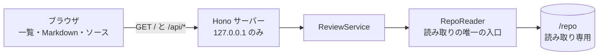

# Stage 1 報告(閲覧・読み取り専用)

作成日: 2026-10-18(同日に T1-8・S1-9・Issue #12 の結果を追記)/ 対象: S1-1〜S1-11、C-1〜C-6 / ブランチ: `feature/12-stage1-followups`(Issue #12)

## 結論(2行以内)

ステージ1の機能と受け入れ基準(S1-1〜S1-11、C-1〜C-6)は、自動テストと手動確認(S1-9)で確認済み。`npm run check` 903 件、`npm run e2e` 219 passed / 1 todo(todo は C-6 の書き込み途中で、ステージ2)。未決だった SPEC の曖昧点は、すべて決定済み。
**人間の残作業**: push(未 push が 3 ブランチ)、T1-7 の CI の初回結果の確認、ステージ2へ進むかの判断。

## 目的・背景

閲覧できないと、コメント(ステージ2)も AI への指示(ステージ3)も始められない。資料(Markdown)とソースを並べて読めることを作る段階。あわせて、HTTP 層のセキュリティ基準(C-1〜C-6)と、ファイル読み取りの拒否規則(S1-4、S1-5)を、回帰テストとして固定した。

## 全体像



Issue #12 では `src/` の実装は変わっていない(変更は単体テスト 3 行・静的チェック 6 行、e2e、SPEC、PLAN)。

## 受け入れ基準の結果

分類: **自動** = 自動テストで確認 / **手動** = 人間の確認 / **一部** = 自動で確認したが、保留の範囲がある。テストの件数は `npm run e2e` の結果(§確認したこと)。

| ID | 結果 | 根拠(テストの describe / 要旨) |
|---|---|---|
| S1-1 | 自動: 満たす | `api.test.ts` の S1-1 群。新しい順(同時刻はファイル名の降順、Q3)。一覧に見出しを含めない(Q8・SPEC 反映済み) |
| S1-2 | 自動: 満たす | `render.test.ts` の S1-2(表、タスクリスト、コードブロック) |
| S1-3 | 自動: 満たす | `render.test.ts` の S1-3(正しい図、不正記法はそのブロックだけ、図の中のスクリプトが実行されない) |
| S1-4 | 自動: 満たす | `api.test.ts` の S1-4 群(`../`、絶対パス、外を指すリンク)。拒否は 404、形式不正は 400(Q4) |
| S1-5 | 自動: 満たす | `api.test.ts` の S1-5 群(`.env*` を `.env.example` も含めて拒否、`.git/`、鍵、`.gitignore` のルートとサブディレクトリ、否定パターンでも秘密は解除されない、パスの書き方の回避)。画面のツリーでも非表示(S1-11 の describe 内の 1 件) |
| S1-6 | 自動: 満たす | `api.test.ts` の S1-6 群。境界: 1,048,576 バイトちょうどは本文を返す、1,048,577 バイトは返さない(Q5)。バイナリは本文なし |
| S1-7 | 自動: 満たす(注意あり) | HTTP 2 件(XSS を含む応答と見出しを含む一覧が HTML の Content-Type でない)。ブラウザ 5 件(`window.__rvXss` が未定義のまま、`javascript:` / `data:` のリンク、閉じない HTML の後ろのペイロード、一覧の見出し、前後の文章が表示される)。空振りの問題は修正済み(§未確認 1) |
| S1-8 | 自動: 満たす | `render.test.ts` の S1-8(`src/example.ts:1` がリンクになり、クリックで並び表示と該当行の強調) |
| S1-9 | **手動: 確認済み** | 2026-10-18 に人間が確認。最初は `REPO_DIR` 未指定で API が 500 になり、S1-10 を追加した(下の付録) |
| S1-10 | 自動: 満たす(端末入力は未カバー) | `startup.test.ts` の 10 件(引数・`REPO_DIR`・`/repo` の優先順、不在・ファイルの拒否、相対パスの基準)。端末での入力は単体テストと擬似端末のみ |
| S1-11 | 自動: 満たす | `render.test.ts` の S1-11 4 件(ディレクトリを開き、ファイルを開くと内容が出る、行番号が 1 始まり、もう一度クリックで閉じる、秘密ファイルが出ない)。**Issue #12 で新設**(旧 ID の借用をやめた) |
| C-1 | 自動: 満たす | `api.test.ts` / `security.test.ts` の C-1 群(許可リスト外の Host は 403。Host が無い・不正は 400 も可、Q12) |
| C-2 | 自動: 満たす | 同 C-2 群(POST/PATCH/DELETE の Origin 検証。GET は Origin が無くても拒否されない) |
| C-3 | 自動: 満たす | `security.test.ts` の C-3(既定は 127.0.0.1)。外部アドレスへの bind の検査は、環境に外部アドレスがあるときだけ動く |
| C-4 | 自動: 満たす | `src/project-setup.test.ts`(`@anthropic-ai/*` への依存が無い)と `src/static-checks.test.ts`(`claude` の起動が無い)。`npm run check` に含む |
| C-5 | 自動: 満たす | `security.test.ts` の C-5(秘密ファイルの中身とトークンが応答に出ない)と単体テスト |
| C-6 | **一部** | `security.test.ts` の C-6 4 件(SIGTERM / SIGINT で、5 秒以内に**終了コード 0** で終了し、ポートが閉じる。プロセスグループ全体に送った場合も含む)は緑。**未カバー**: 書き込み途中のシグナル(`it.todo`、ステージ2)。コンテナ内の PID 1 でのシグナル処理(ステージ5) |

## 確認したこと

| 項目 | コマンド | 結果(2026-10-18、このコンテナで Reporter が実行) |
|---|---|---|
| 検査 | `npm run check` | **通過**。26 ファイル、903 件すべて通過(typecheck、lint、単体テスト) |
| ビルド | `npm run build` | 成功(終了コード 0) |
| システムテスト | `npm run build` の後に `npm run e2e` | **219 passed / 1 todo**、失敗 0、4 ファイル。内訳: `api.test.ts` 118、`security.test.ts` 67、`render.test.ts` 24(うちブラウザ)、`startup.test.ts` 10。todo は C-6 の書き込み途中 1 件 |
| 基準 ID で絞り込み | `npm run e2e -- -t S1-x` | Reporter は未実行(全件の実行で代えた) |
| 差し戻し回数 | (Reviewer の判定記録) | Issue #12 の各 Reviewer は APPROVE。**差し戻しの回数の記録は見つからず、未確認** |

- 実行の条件: 開発コンテナに Chromium の OS ライブラリが無いため、`LD_LIBRARY_PATH` と `FONTCONFIG_FILE` を scratchpad 側に向けて実行した(README の Playwright の節)。
- リモート(`git ls-remote origin`、Reporter が確認): `main`、`develop`、`feature/6`、`feature/8`、`feature/9`、`feature/10` がある。`feature/8` と `feature/9` はローカルと同じコミット。`feature/10` はローカルが 2 コミット先行。`feature/11`、`feature/12` は未 push。

## 未確認・懸念点

1. **S1-7 の `javascript:` リンクの検証は、空振りのおそれがあった → 解消。** 前回の報告の懸念。Tester が 83e6d33 で XSS フィクスチャを直し、テストは「リンクの文字が表示されること」を先に確かめるようになった(`e2e/render.test.ts`、約 379 行)。Reporter は、テストの冒頭でリンクの文字の表示を待つことを読んで確認した。
2. **CI(T1-7)の初回の結果は未確認。** push 後に GitHub Actions が緑になるかは、人間の確認が要る。赤の場合は、そこで止めて報告する。
3. **実機の確認(S1-9 以外)**: 巨大ファイル・バイナリの「表示できません」の表示、ソースツリーの見た目、Mermaid の図の見た目は、自動テストの対象外。下の「画面を確かめる手順」を参照。
4. **Chromium のみ。** ほかのブラウザの表示は未検証(Q14 の決定どおり)。
5. **S1-10 の端末での入力**(Ctrl-C、Ctrl-D、入力のやり直し)は e2e では検証していない。単体テストと擬似端末で確認したのみ。
6. **Tester が書いたテストの、Reviewer の軽微な提案(未対応、任意)**:
   - C-6 のテストは、サーバー本体の node プロセスを探してシグナルを送る。見つからなければ失敗するので、黙って通ることはない(Q1 の決定どおり、今の方法で十分)。
   - Q8 のテストは、XSS フィクスチャの見出しを流用している。見出しを変えると、テストの意味が変わる。
   - S1-5 の画面テスト(ツリーに秘密ファイルが出ない)が、S1-11 の describe の中にある。
7. **セキュリティの仮定(人間の判断が要る。下の C)**: Mermaid の SVG の無害化は、Mermaid の `securityLevel: 'strict'` が内部で使う DOMPurify に依存する(Reporter は独立に確認していない)。CSP の `style-src 'unsafe-inline'` を許している。
8. **暫定の方針**(SPEC に規定が無い、または仮の値): ハイライトの上限 200,000 文字(`src/client/source-lines.ts`)、`path:line` の検出の限界(`example.com:8080` のようなポート番号つきのホスト名、`src/日本.ts:3` のような非 ASCII のパス)、インラインコードは全体が 1 つの参照のときだけリンク。e2e の `api.test.ts` はステータスコードを 5xx 以外なら受け入れる。
9. **`npm start` の既定の `DATA_DIR`(`/data`)** で起動するかは未確認。手動確認では `DATA_DIR` を明示する。
10. **ビルドの警告**: 500kB を超えるチャンク(mermaid、elk)。`dist/client` は約 16MB。
11. **開発コンテナの Chromium**: `/workspace/vibe_coding/docker/Dockerfile` の手順 3.6 は、ビルドを未検証(このコンテナに podman が無い)。CI は `--with-deps` を使うので影響は無い。
12. **gitleaks の pre-push フック(`557d3e3`)**は、Reviewer を通していない。初回の push の前に、履歴全体を gitleaks で確認する(CLAUDE.md)。Reporter は未実行。

## 人間に判断してほしいこと

**A. 次に行うこと(承認が要る)**

1. **push**: 未 push は `feature/10`(2 コミット)、`feature/11`、`feature/12`。`feature/8`、`feature/9` は、リモートと同じコミットで、追加の push は不要。push の順番と、`develop` へのマージの順番は人間が決める。初回の push の前に gitleaks で履歴を確認する(未確認)。
2. **T1-7 の CI の初回結果の確認**(上の 2)。
3. **ステージ2へ進むか。** おすすめ: 進む。ステージ2の前提(書き込み途中のシグナル、C-6 の todo)は、ステージ2の作業に含まれる。

**B. 設計・依存の判断(おすすめは「受け入れる」)**

- **CSP の `style-src 'unsafe-inline'`**: Mermaid の SVG が `<style>` を含むため。スタイルからの情報漏えいのリスクは小さいと Reporter は見る。おすすめ: ステージ1は受け入れ、ステージ3(MCP)の前に見直す。
- **Mermaid の内部の無害化への依存**: `securityLevel: 'strict'` と、CSP の `script-src 'self'` の二重。おすすめ: 受け入れる。
- **依存の追加**(記録は `doc/oss.md`。いずれも MIT。ただし playwright は Apache-2.0): 実行時に react、react-dom、react-markdown、remark-gfm、rehype-sanitize、unified、remark-parse、mermaid、shiki、ignore。開発時に playwright、@vitejs/plugin-react、@types/react、@types/react-dom。Chromium 本体は npm の依存ではなく、`npx playwright install` で別に入る(ライセンスの一部は未確認)。

**C. 決定済み(Issue #12 で確定。SPEC と PLAN に反映済み)**

- Q1〜Q2(#12)、Q4、Q6〜Q12、Q3、Q5、Q7。内容は付録 A。

## 画面を自分で確かめる手順(S1-9 以外の実機確認)

```bash
cd /workspace/vibe_coding/review-viewer
npm run build
DATA_DIR=/書き込み可能なディレクトリ npm start -- /実際のプロジェクトのパス
```

- [ ] `http://127.0.0.1:3000/` を開き、左にレポート一覧が出る
- [ ] レポートを開くと、本文が表示される(見出し、表、タスクリスト、コードブロックのハイライト)
- [ ] Mermaid の図が描画される(不正な図があれば、そのブロックだけがエラーになる)
- [ ] `src/...:番号` のリンクをクリックすると、右にソースが並び、該当行へ移動して強調される
- [ ] ソースツリーを開閉して、別のファイルを開ける。`.env` や `.gitignore` の対象が出ない
- [ ] 1MB を超えるファイルやバイナリを開くと、「表示できません」と出る
- [ ] 終了は Ctrl+C で、エラーなく終わる

## 付録

### A. 決定の記録(Issue #12 まで)

| # | 論点 | 決定 | 反映先 |
|---|---|---|---|
| Q3 | 「新しい順」 | 更新日時の降順。同時刻はファイル名の降順 | SPEC S1-1 |
| Q5 | 1MB の定義 | 1,048,576 バイト。ちょうどは返す、超えたら返さない | SPEC S1-6 |
| Q4 | 拒否のステータス | 拒否は 404(存在しないパスと同じ)。形式不正(`../`、絶対パス)は 400 でよい | SPEC 拒否の応答 |
| Q6 | `.env.example` | 拒否する | SPEC S1-5 |
| Q7 | 「正常終了」 | 終了コード 0、5 秒以内。e2e で検証済み | SPEC C-6 |
| Q8 | `/api/reports` の見出し | 一覧に見出しを出さない(ファイル名だけ) | SPEC S1-1 |
| Q9 | `.gitignore` の範囲 | ルートとサブディレクトリ、否定パターンも git と同じ意味で扱う。秘密の判定は常に優先 | SPEC S1-5 |
| Q10 | `reports/` のサブディレクトリ | 含めない(直下の `.md` だけ) | SPEC S1-1 |
| Q11 | 外を指すシンボリックリンク | 一覧に出さない | SPEC S1-4 |
| Q12 | `Host` が無い・不正 | 400 も 403 も可 | SPEC C-1 |
| Q1(#12) | C-6 の終了コードの確かめ方 | 今の方法で十分。コンテナでの確認はステージ5 | PLAN |
| Q2(#12) | ツリー操作の基準 ID | S1-11 を新設。テストを付け替えた | SPEC S1-11、PLAN |
| — | §4.1 の `data-testid` 2 件 | `source-line-number`、`source-tree` を SPEC に追記 | SPEC §4.1 |

### B. Issue #12 の経過(追記)

- **決定**: 2026-10-18(2回目)に、人間が Q4・Q6〜Q12 を「すべておすすめ」で決定。3回目で Q1・Q2 を決定。
- **847a38d**(SPEC): C-1、C-6、S1-1、S1-4、S1-5、拒否の応答を反映。§4.1 に 2 件の `data-testid` を追加。
- **6adcd13**(Coder): `TODO(T1-P1)` の静的チェックの例外を既定に戻した(T1-P1 は `ac6e446` で完了済み)。`resolveBaseDir` の単体テストを追加。
- **83e6d33**(Tester): 決定に合わせてテストを締めた。ツリー操作(S1-11)と C-6 の終了コード 0 のテストを追加。XSS フィクスチャの空振りを修正(`2026-08-05-xss-unclosed-block.md` を新設)。
- **a553ef4**(SPEC): S1-11 を新設。**0519448**(Tester): テストの ID を S1-11 に付け替え。**5bad877**(PLAN): Q1・Q2 の決定を記録。
- **差し戻し**: Reviewer は全タスクで APPROVE。回数の記録は見つからず、未確認。
- **Reviewer の軽微な提案**: 上の未確認 6(未対応、任意)。

### C. 解消した懸念(前回の報告から)

- S1-7 の `javascript:` リンクの空振り(上の未確認 1)→ 解消。
- §4.1 にない `data-testid`(旧 5)→ SPEC に追記して解消。
- `TODO(T1-P1)` の残存(旧 15)→ 解消(6adcd13)。
- C-6 の終了コード(Q7)→ テストに含めた(83e6d33)。
- 1MB の境界・並び順(旧 3)→ SPEC に反映済み。

### D. 主な変更点(前回までの経過)

- 範囲: `f9a51a2`(文書の初回)から `4530c8e` まで。90 ファイル、追加 18,023 行、削除 55 行(`package-lock.json` を含む)。
- 主なコミット: T1-0 `71eba6d`、T1-1 `9af0502`、T1-N1 `0b1ffba`(Node.js 22 以上)、T1-2 `903056e`(RepoReader)、T1-6 `c411315`(C-4)、T1-P1 `ac6e446`(Playwright)、T1-7 `565d8ed`(CI)、T1-3 `6ff83d0`、T1-4 `111a382`、T1-5 `4530c8e`、T1-8 `ceea833`(S1-10。テストは `34d30fd`)。
- Issue #12: `847a38d`、`6adcd13`、`83e6d33`、`a553ef4`、`0519448`、`5bad877`。
- 設計上の選択:
  - **拒否を 404 に統一**: 秘密ファイルの有無を、応答の違いから推測させないため(`RepoReader.ts`)。
  - **秘密の判定は `.gitignore` より常に優先**。否定パターンでも解除されない。
  - **画面は React + Vite、Markdown は `react-markdown`**(HTML の文字列を作って挿入しない)。`dangerouslySetInnerHTML` は Mermaid の SVG だけに使う。
  - **`path:line` のリンクの `href` は必ず `buildRoute` で作る**(文書由来の値を URL にそのまま入れない)。
  - **システムテストは Chromium で行う**(Vitest から `playwright` ライブラリを呼ぶ案 A)。ランナーは Vitest のまま。
  - **対象リポジトリの決め方(S1-10)**: 引数 → `REPO_DIR` → `/repo`(存在する場合)→ 端末なら入力 → それ以外は終了コード 1。相対パスは起動したディレクトリを基準。`npm run dev` は Vite と API を 1 プロセス・1 ポートで起動し、Host / Origin の検証をそのまま働かせる。
- 暫定の仮定(Tester と Coder): 終了までの待ちは 20 秒、理由の出力先は stdout と stderr のどちらでもよい。引数が 2 個以上・空文字はエラー、入力の中断(Ctrl-C、EOF)は終了コード 0。

### E. 依存の一覧

詳細は `doc/oss.md`。上の「人間に判断してほしいこと」B を参照。

### F. 参照

- SPEC: `/workspace/vibe_coding/review-viewer/SPEC.md`(§4 の受け入れ基準と画面の契約)
- PLAN: `/workspace/vibe_coding/review-viewer/PLAN.md`(タスク、決定の記録、手動確認の表)
- 依存の一覧: `/workspace/vibe_coding/review-viewer/doc/oss.md`
- 起動と Chromium の入手: `/workspace/vibe_coding/review-viewer/README.md`
